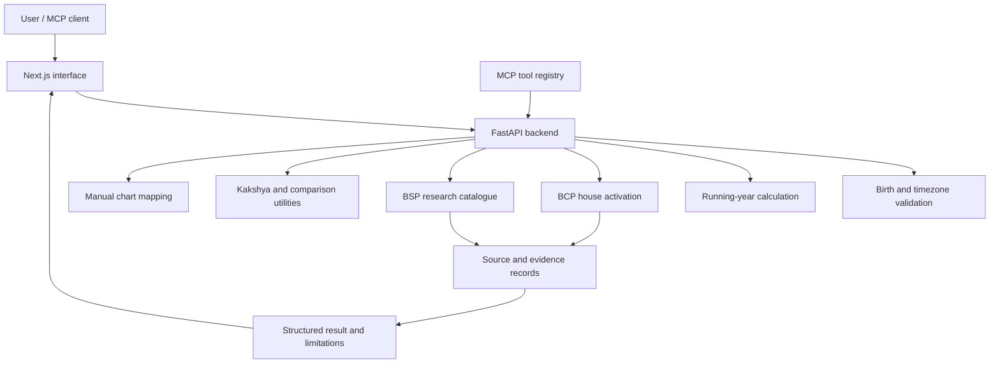

# BhriguSetu

<div align="center">

## A research-first workspace for Bhrigu Chakra Paddhati (BCP) and Bhrigu Saral Paddhati (BSP)

**Live website:** [https://bhrigusetu.vercel.app](https://bhrigusetu.vercel.app)

**Traditional Jyotish research, implemented with transparent calculations, traceable sources and explicit limitations.**

[](https://github.com/beshivaayy/bhrigusetu)
[](https://fastapi.tiangolo.com/)
[](https://nextjs.org/)
[](https://github.com/beshivaayy/bhrigusetu)
[](LICENSE)

[Overview](#overview) · [Capabilities](#current-capabilities) · [Methodology](#methodology--source-policy) · [Architecture](#architecture) · [Quick start](#quick-start) · [Documentation](#documentation)

</div>

---

## Overview

BhriguSetu is a research-first software project for **Bhrigu Chakra Paddhati (BCP)** and **Bhrigu Saral Paddhati (BSP)**. It brings birth-data validation, running-year arithmetic, house activation, research-rule catalogues and reproducible utilities into one application.

> **A calculation is not an interpretation, an interpretation is not a source, and a source is not automatically a verified rule.**

The project keeps these layers separate so you can inspect how a result was produced, which assumptions were used and what remains uncertain.

## Current capabilities

This table describes what actually works on `main` — not planned work.

| Area | Status | Notes |
| --- | --- | --- |
| Birth details | Implemented | Validates date, local wall time, coordinates and IANA timezone |
| Birthplace search | Implemented | One-shot OpenStreetMap Nominatim lookup with attribution |
| Timezone resolution | Implemented | UTC conversion with DST gap/repeated-time safeguards |
| Running year | Implemented | Birthday-based completed-years-plus-one calculation using selected local date |
| BCP house activation | Implemented | 12-house activation arithmetic based on documented method steps |
| BCP cycle labels | Provisional | Not promoted as verified rules |
| BCP trigger-point dates | Disabled | Degree-to-day interpretation needs source clarification |
| BSP rule catalogue | Research stage | Five source-linked candidates; predictive matching disabled |
| BSP-7 Kakshya | Implemented utility | Eight divisions of 3°45′; lookup only, not a standalone prediction |
| Birth-chart calculation | Implemented, approximate | Astronomy Engine 2.1.19; approximate Lahiri polynomial, mean nodes, whole-sign houses and D1/D9; not JHora parity |
| JHora public REST provider | Implemented as explicit API/MCP option | Configurable ayanamsha, Mean/True node, Drik/SS and Bhava methods; calculation receipt records applied settings; separate provider, not desktop-JHora parity |
| Granthalaya catalogue | Implemented — first release | Searchable catalogue with classical text records, BCP/BSP research notes and a study path; edition verification and persistent reading tools remain future work |
| Manual chart import | Implemented | Maps caller-supplied sidereal longitudes; does not verify their ephemeris |
| MCP interface | Implemented | Exposes existing calculation and research functions |

**Scope:** BhriguSetu is a research and calculation foundation, not a complete horoscope generator or automated prediction service. The in-repository Astronomy Engine remains approximate; the independent JHora public REST provider is available as an explicit calculation path. Neither path establishes parity with the desktop JHora application.

## Methodology & source policy

Modern teaching sources are prioritised in this order:

1. **Sunil John** — first priority for BCP/BSP-specific material and source context.
2. **Deepanshu Giri** — second priority for practical teaching and cross-checking.
3. **Sanjay Rath** — third priority for foundational Jyotish research and corroboration.

Other authors may be included as supplementary references, clearly attributed. Different teachers' views must not be silently merged into one generic rule.

### Classical texts are a separate evidence layer

Classical works such as *Brihat Parashara Hora Shastra*, *Phaladeepika*, *Laghu Parashari* and *Jaimini Sutras* are recorded separately from modern lectures, courses and interpretations.

Each research entry should identify the source and exact location (chapter, shloka, page or timestamp), distinguish original wording from interpretation, state preconditions, include a worked example and record evidence status and conflicts. A general Parashari principle is not automatically a BCP or BSP rule.

### Evidence before prediction

Before a rule can be enabled, it needs a traceable source and exact location, clear preconditions and calculation steps, a reproducible worked example, conflict review, deterministic implementation and regression tests. Unverified BSP candidates remain disabled. Conflicts are documented, not averaged away.

## Calculation integrity

Calculation conventions materially affect chart results. BhriguSetu treats birth date, local civil time, coordinates, IANA timezone, UTC conversion and calculation-provider settings as explicit inputs.

**Jagannatha Hora (JHora) is the intended reference target for chart-calculation validation.** The in-repo engine uses Astronomy Engine 2.1.19, an approximate Lahiri polynomial, Mean Nodes and Whole Sign houses; True Node, alternative ayanamsha modes and alternative bhava systems are not implemented in that engine. Any provider integration must expose only verified settings, preserve the exact calculation profile and reject unsupported options rather than silently substituting defaults.

- [JHora public REST API](https://jagannathahora.com/api-mcp)
- [JHora public MCP guide](https://jagannathahora.com/api-mcp/mcp-usage)

The public API/MCP service is a separate provider; it must not be described as the desktop JHora application itself. BhriguSetu exposes an explicit public REST provider path; its calculation receipt preserves requested/applied settings and engine revision.

## Acknowledgements & source credits

BhriguSetu is built with gratitude to the teachers, authors, researchers and knowledge traditions from which its creator has learned.

### Teachers and guiding influences

- **Sunil John** — for the teachings, guidance and knowledge that have helped shape the creator's understanding and research into BCP and BSP.
- **Deepanshu Giri** — for sharing Jyotish knowledge, practical insights and teaching that have contributed to the creator's learning and continued study.
- **Sanjay Rath** — for his extensive contributions to Jyotish education, traditional study and the wisdom that has informed the creator's learning and research approach.

These acknowledgements express gratitude for learning and intellectual influence. They do not imply endorsement of BhriguSetu, collaboration, affiliation or review by the individuals named. Their teachings and authored materials remain theirs; BhriguSetu does not claim ownership over them.

Every other Jyotish teacher, author, scholar and researcher whose publicly shared or properly accessed work informs a specific part of this project is credited by name alongside the relevant research entry, with a source link and — where available — a lecture timestamp, publication, page or chapter reference. No contributor is represented as a source for a rule unless that attribution has been verified.

The project also acknowledges the authorship, preservation, translation and scholarship associated with classical Jyotish works, including *Brihat Parashara Hora Shastra*, *Phaladeepika*, *Laghu Parashari* and *Jaimini Sutras*. Specific editions, translators, editors and shloka references are identified wherever they are used; traditional knowledge is not claimed as original project intellectual property.

**Our principle:** give credit where knowledge came from, distinguish quotation from interpretation and distinguish both from BhriguSetu's own implementation or analysis. If a source or contributor is missing or incorrectly attributed, please [open an issue](https://github.com/beshivaayy/bhrigusetu/issues) so the record can be corrected.

See [Acknowledgements and attribution policy](ACKNOWLEDGEMENTS.md) for the full credit standard.

## Architecture



| Repository path | Responsibility |
| --- | --- |
| `frontend/` | Next.js + TypeScript user interface |
| `backend/` | FastAPI application and calculation modules |
| `research/` | Method specifications, source matrix and conflicts |
| `docs/` | Architecture, MCP, deployment and implementation guides |

## Quick start

### Requirements

- Python 3.12, Node.js/npm and Git
- Docker Desktop (optional)

### 1. Clone

```bash
git clone https://github.com/beshivaayy/bhrigusetu.git
cd bhrigusetu
```

### 2. Backend

```powershell
cd backend
py -3.12 -m venv .venv
.\.venv\Scripts\Activate.ps1          # on Linux/macOS: source .venv/bin/activate
python -m pip install -r requirements.txt
python -m uvicorn app.main:app --reload --port 8000
```

- Health: [http://localhost:8000/health](http://localhost:8000/health)
- OpenAPI docs: [http://localhost:8000/docs](http://localhost:8000/docs)
- Analysis: `POST /api/analyze` · Chart: `POST /api/chart/calculate` · Manual chart: `POST /api/chart/manual` · MCP: `/mcp` (remote deployment requires Bearer authentication)

### 3. Frontend

From a second terminal at the repository root:

```powershell
cd frontend
npm ci
$env:NEXT_PUBLIC_API_BASE_URL = "http://localhost:8000"   # on Linux/macOS: export NEXT_PUBLIC_API_BASE_URL=http://localhost:8000
npm run dev
```

Open [http://localhost:3000](http://localhost:3000).

### 4. Tests

```powershell
cd backend
python -m pytest -q
```

### 5. Docker (optional)

```powershell
docker compose up --build
```

Stop with `Ctrl+C`, then `docker compose down`.

## Configuration

| Variable | Component | Purpose |
| --- | --- | --- |
| `NEXT_PUBLIC_API_BASE_URL` | Frontend | FastAPI base URL; defaults to `http://localhost:8000` |
| `CORS_ORIGINS` | Backend | Comma-separated allowed frontend origins |
| `BHRIGUSETU_MCP_TOKEN` | Backend | Bearer token protecting the remote MCP endpoint |

Never commit API keys, tokens, passwords or local environment files. Use HTTPS for deployed API origins and restrict CORS to the exact frontend origin.

## Deployment

The intended split deployment is **Vercel** for the frontend (root directory `frontend/`) and **Render** for the backend (`render.yaml` at the repository root plus `backend/Dockerfile`). A configuration file does not by itself guarantee that a service is deployed or healthy — verify the deployed commit, health checks, CORS and logs. Follow [docs/DEPLOYMENT.md](docs/DEPLOYMENT.md).

## Privacy, external services and licensing

- Birthplace lookup uses OpenStreetMap Nominatim. The UI displays attribution; follow its usage policy and do not turn one-shot search into uncontrolled autocomplete.
- The in-repo chart engine uses Astronomy Engine 2.1.19 (MIT) and an approximate Lahiri polynomial. Provider/version and calculation warnings accompany chart output.
- Swiss Ephemeris is not bundled. Its dual licensing requires a deliberate AGPL-compliance or professional-licence decision before integration.
- The public JHora API has its own usage terms, rate limits and availability conditions. Credit the provider, cache appropriately and do not assume an uptime guarantee.
- Birth date, time and location are personal data. Review hosting and external-provider privacy terms before sending them to third-party services.

## Licence

BhriguSetu is licensed under the **Business Source License 1.1** ([LICENSE](LICENSE)): the code is source-available for non-commercial research, education and personal study, and converts to **GPLv3-or-later** on **2030-11-18**.

Third-party libraries, datasets, classical texts, teacher-authored material and external calculation providers retain their own licences and terms. This licence applies only to original BhriguSetu project code.

## Roadmap

- [x] BCP running-year and 12-house activation foundation
- [x] Source-controlled BSP research catalogue with predictive rules disabled
- [x] BSP-7 Kakshya lookup utility
- [x] FastAPI service and Next.js interface
- [x] BhriguSetu MCP server with remote authenticated endpoint
- [x] Initial approximate D1/D9 chart engine and invariant tests
- [x] Verify the JHora public REST request contract and register the provider in BhriguSetu API/MCP
- [x] Document the provider capability matrix for supported ayanamsha, node type, calculation and Bhava settings
- [x] Add a bounded, process-local JHora response cache (5-minute TTL, 128-entry limit, settings- and engine-revision-aware key)
- [x] Integrate the JHora public REST provider as a distinct, explicitly selected API/MCP calculation path
- [ ] Add per-chart calculation profiles and persist the full settings receipt
- [ ] Build authorized desktop-JHora reference fixtures and angular-error comparison reports
- [ ] Expand frontend rendering of provider vargas and validate Bhava / house-system outputs
- [ ] Verify BCP cycle-swami and trigger-point interpretations from primary sources
- [ ] Enable BSP predictive rules only after provenance, worked examples and regression tests pass

## Documentation

| Document | Description |
| --- | --- |
| [Architecture](docs/ARCHITECTURE.md) | Application layers and responsibility boundaries |
| [MCP server](docs/MCP_SERVER.md) | Available tools, transports and client setup |
| [JHora REST provider contract](docs/JHORA_REST_PROVIDER_CONTRACT.md) | Verified settings, provider attribution, failure handling and parity gates |
| [Deployment](docs/DEPLOYMENT.md) | Render, Vercel, CORS and release verification |
| [Place search](docs/PLACE_SEARCH.md) | Nominatim usage and timezone lookup safeguards |
| [Manual chart import](docs/MANUAL_CHART_IMPORT.md) | Caller-supplied longitudes and mapping limitations |
| [Astronomy & licensing](research/ASTRONOMY_AND_LICENSING.md) | Ephemeris choices, precision and licensing |
| [BCP specification](research/BCP_SPECIFICATION.md) | BCP calculation scope and assumptions |
| [BCP cycle-lord evidence](research/BCP_CYCLE_LORD_EVIDENCE.md) | Evidence for provisional cycle-ruler mapping |
| [BCP trigger points](research/BCP_TRIGGER_POINTS.md) | Unresolved trigger-point method |
| [BSP specification](research/BSP_SPECIFICATION.md) | BSP research scope and implementation boundaries |
| [BSP rule register](research/BSP_RULE_REGISTER.md) | Candidate rules, sources and verification status |
| [BSP Kakshya evidence](research/BSP_KAKSHYA_EVIDENCE.md) | Kakshya lookup research |
| [Source matrix](research/SOURCE_MATRIX.md) | Source inventory and evidence status |
| [Conflicts](research/CONFLICTS.md) | Conflicting interpretations and open questions |
| [Security policy](SECURITY.md) | Reporting security issues |
| [Acknowledgements](ACKNOWLEDGEMENTS.md) | Gratitude to teachers and point-of-use attribution |

## Contributing

Contributions are welcome, especially in:

- Reproducible chart fixtures and independent calculation comparisons
- Primary-source references and careful source transcription
- Tests for boundaries, timezone transitions and divisional-chart calculations
- Documentation improvements and provider capability audits

Use public issues and pull requests for documentation corrections, reproducible bug reports and discussion; do not assume a code contribution grants or transfers intellectual-property rights. Contributions to the calculation/research core require a written contributor/IP agreement before acceptance.

Before proposing a predictive rule, include its source, exact location, preconditions, worked example, expected output and regression test. Unattributed rules should not be submitted as established BCP/BSP doctrine.

---

<div align="center">

**BhriguSetu** · Bridging traditional Jyotish research and disciplined software engineering — built for careful calculation, honest research and traceable Jyotish.

[Repository](https://github.com/beshivaayy/bhrigusetu) · [Issues](https://github.com/beshivaayy/bhrigusetu/issues) · [JHora API](https://jagannathahora.com/api-mcp)

</div>
