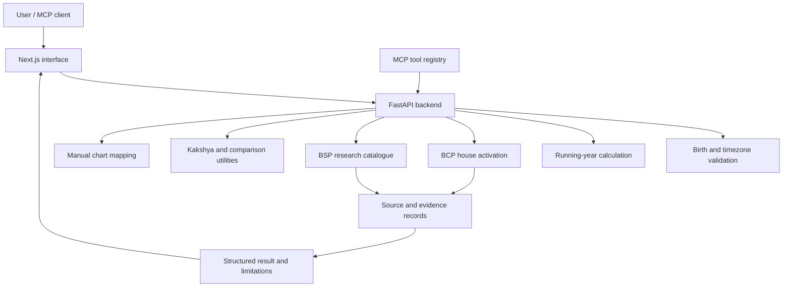

# BhriguSetu

<div align="center">

### A research-first workspace for Bhrigu Chakra Paddhati (BCP) and Bhrigu Saral Paddhati (BSP)

**Traditional Jyotish research, implemented with transparent calculations, traceable sources and explicit limitations.**

[](https://github.com/beshivaayy/bhrigusetu)
[](https://fastapi.tiangolo.com/)
[](https://nextjs.org/)
[](https://github.com/beshivaayy/bhrigusetu)

[Overview](#overview) · [Capabilities](#current-capabilities) · [Methodology](#methodology--source-policy) · [Architecture](#architecture) · [Quick start](#quick-start) · [Documentation](#documentation)

</div>

---

## Overview

BhriguSetu is a research-first software project for **Bhrigu Chakra Paddhati (BCP)** and **Bhrigu Saral Paddhati (BSP)**. It brings birth-data validation, running-year arithmetic, house activation, research-rule catalogues and reproducible utilities into one application.

> **A calculation is not an interpretation, an interpretation is not a source, and a source is not automatically a verified rule.**

The project keeps these layers separate so users can inspect how a result was produced, which assumptions were used and what remains uncertain.

## Current capabilities

This table describes the implementation on the `main` branch—not planned work.

| Area | Status | Notes |
| --- | --- | --- |
| Birth details | Implemented | Validates date, local wall time, coordinates and IANA timezone |
| Birthplace search | Implemented | One-shot OpenStreetMap Nominatim lookup with attribution |
| Timezone resolution | Implemented | UTC conversion with DST gap/repeated-time safeguards |
| Running year | Implemented | Birthday-based completed-years-plus-one calculation using selected local date |
| BCP house activation | Implemented | 12-house activation arithmetic based on documented method steps |
| BCP cycle labels | Provisional | Not promoted as verified rules |
| BCP trigger-point dates | Disabled | Degree-to-day interpretation needs source clarification |
| BSP rule catalogue | Research stage | Five source-linked candidates; predictive matching disabled |
| BSP-7 Kakshya | Implemented utility | Eight divisions of 3°45′; lookup only, not a standalone prediction |
| Birth-chart calculation | Implemented, approximate | Astronomy Engine 2.1.19; approximate Lahiri polynomial, mean nodes, whole-sign houses and D1/D9; not JHora parity |
| Manual chart import | Implemented | Maps caller-supplied sidereal longitudes; does not verify their ephemeris |
| MCP interface | Implemented | Exposes existing calculation and research functions |

**Scope:** this branch is a partial calculation and research foundation, not a complete horoscope generator or automated prediction service. Chart-engine development is maintained separately and is not a released capability until merged and validated.

## Methodology & source policy

Modern teaching sources are prioritised in this order:

1. **Sunil John** — first priority for BCP/BSP-specific material and source context.
2. **Deepanshu Giri** — second priority for practical teaching and cross-checking.
3. **Sanjay Rath** — third priority for foundational Jyotish research and corroboration.

Other authors may be included as supplementary references, clearly attributed. Different teachers' views must not be silently merged into one generic rule.

### Classical texts are a separate evidence layer

Classical works such as *Brihat Parashara Hora Shastra*, *Phaladeepika*, *Laghu Parashari* and *Jaimini Sutras* are recorded separately from modern lectures, courses and interpretations.

Each research entry should identify the source and exact location (chapter, shloka, page or timestamp), distinguish original wording from interpretation, state preconditions, include a worked example and record evidence status and conflicts. A general Parashari principle is not automatically a BCP or BSP rule.

### Evidence before prediction

Before a rule can be enabled, it needs a traceable source and exact location, clear preconditions and calculation steps, a reproducible worked example, conflict review, deterministic implementation and regression tests. Unverified BSP candidates remain disabled. Conflicts are documented, not averaged away.

## Calculation integrity

Calculation conventions materially affect chart results. BhriguSetu treats birth date, local civil time, coordinates, IANA timezone, UTC conversion and calculation-provider settings as explicit inputs.

**Jagannatha Hora (JHora) is the intended reference target for chart-calculation validation.** The `main` branch contains an initial approximate birth-chart engine, but it does not claim JHora parity. The in-repo engine uses Astronomy Engine 2.1.19, an approximate Lahiri polynomial, Mean Nodes and Whole Sign houses; True Node, alternative ayanamsha modes and alternative bhava systems are not implemented in that engine. Any provider integration must expose only verified settings, preserve the exact calculation profile and reject unsupported options rather than silently substituting defaults.

- [JHora public REST API](https://jagannathahora.com/api-mcp)
- [JHora public MCP guide](https://jagannathahora.com/api-mcp/mcp-usage)

The public API/MCP service is a separate provider; it must not be described as the desktop JHora application itself.

## Acknowledgements & source credits

BhriguSetu is built with gratitude to the teachers, authors, researchers and knowledge traditions from which its creator has learned. The project aims to acknowledge intellectual contributions clearly and respectfully.

### Teachers and guiding influences

Our special gratitude goes to:

- **Sunil John** — for the teachings, guidance and knowledge that have helped shape the creator's understanding and research into Bhrigu Chakra Paddhati (BCP) and Bhrigu Saral Paddhati (BSP).
- **Deepanshu Giri** — for sharing Jyotish knowledge, practical insights and teaching that have contributed to the creator's learning and continued study.
- **Sanjay Rath** — for his extensive contributions to Jyotish education, traditional study and the wisdom that has informed the creator's learning and research approach.

These acknowledgements express gratitude for learning and intellectual influence. They do not imply endorsement of BhriguSetu, collaboration, affiliation or review by the individuals named. Their teachings and authored materials remain theirs; BhriguSetu does not claim ownership over them.

### Other teachers, authors and researchers

We are also grateful to every other Jyotish teacher, author, scholar and researcher whose publicly shared or properly accessed work informs a specific part of this project. They will be credited by name alongside the relevant research entry, with a source link and—where available—a lecture timestamp, publication, page or chapter reference. No contributor should be represented as a source for a rule unless that attribution has been verified.

### Classical knowledge and information sources

BhriguSetu also acknowledges the authorship, preservation, translation and scholarship associated with classical Jyotish works, including *Brihat Parashara Hora Shastra*, *Phaladeepika*, *Laghu Parashari* and *Jaimini Sutras*. Specific editions, translators, editors and shloka references will be identified wherever they are used; traditional knowledge is not claimed as original project intellectual property.

Software libraries, ephemeris/calculation providers, APIs, datasets, documentation, open-source maintainers and other information providers will be credited in the relevant notices or source registers according to their licences and attribution terms. The [Source matrix](research/SOURCE_MATRIX.md) records research references and evidence status.

**Our principle:** give credit where knowledge came from, distinguish quotation from interpretation and distinguish both from BhriguSetu's own implementation or analysis. If a source or contributor is missing or incorrectly attributed, please open an issue so the record can be corrected.

See [Acknowledgements and attribution policy](ACKNOWLEDGEMENTS.md) for the full credit standard.

## Architecture



| Repository path | Responsibility |
| --- | --- |
| `frontend/` | Next.js + TypeScript user interface |
| `backend/` | FastAPI application and calculation modules |
| `research/` | Method specifications, source matrix and conflicts |
| `docs/` | Architecture, MCP, deployment and implementation guides |

## Quick start

### Requirements

Python 3.12 recommended, Node.js/npm compatible with the frontend lockfile, and Git. Docker Desktop is optional.

### 1. Clone

```powershell
git clone https://github.com/beshivaayy/bhrigusetu.git
cd bhrigusetu
```

### 2. Backend

```powershell
cd backend
py -3.12 -m venv .venv
.\.venv\Scripts\Activate.ps1
python -m pip install -r requirements.txt
python -m uvicorn app.main:app --reload --port 8000
```

API health: [http://localhost:8000/health](http://localhost:8000/health) · API docs: [http://localhost:8000/docs](http://localhost:8000/docs)

### 3. Frontend

Open a second terminal from the repository root:

```powershell
cd frontend
npm ci
$env:NEXT_PUBLIC_API_BASE_URL = "http://localhost:8000"
npm run dev
```

Open [http://localhost:3000](http://localhost:3000).

### 4. Tests

```powershell
cd backend
python -m pytest -q
```

### 5. Docker (optional)

From the repository root:

```powershell
docker compose up --build
```

Open [http://localhost:3000](http://localhost:3000). Stop with `Ctrl+C`, then run `docker compose down`.

## Configuration

| Variable | Component | Purpose |
| --- | --- | --- |
| `CORS_ORIGINS` | Backend | Comma-separated allowed frontend origins |
| `NEXT_PUBLIC_API_BASE_URL` | Frontend | FastAPI base URL; defaults to `http://localhost:8000` |

Never commit API keys, tokens, passwords or local environment files. Use HTTPS for deployed API origins and configure CORS for the exact frontend origin.

## Deployment

The intended split deployment is **Vercel** for the frontend (root directory `frontend/`) and **Render** for the backend (repository Render configuration and backend Dockerfile). Configuration files do not guarantee that a service is deployed or healthy. Follow [docs/DEPLOYMENT.md](docs/DEPLOYMENT.md) and verify the deployed commit, health checks, CORS and logs.

## Ownership and distribution

BhriguSetu follows a **hybrid product model**: the hosted product and selected public interfaces may be accessible, while the proprietary calculation, research and service implementation is intended to remain private. The repository is currently public; the private-core separation is a migration target, not yet completed. See [Ownership and distribution policy](docs/OWNERSHIP_AND_DISTRIBUTION.md).

**Current source status:** no project-level software licence has been added. The absence of a licence does not make the project open source; default copyright applies to original project code. GitHub users can still view and fork a public repository under GitHub's platform terms. Public visibility also means the existing source, branches and history have already been exposed; changing visibility later cannot recall existing public forks or local copies.

Do not treat third-party libraries, public-domain/classical texts, teacher-authored material, public API providers or user-supplied data as BhriguSetu-owned intellectual property. Their respective rights, licences, terms and attribution requirements remain separate.

## External services, privacy & licensing

- Birthplace lookup uses OpenStreetMap Nominatim. Attribution is displayed; follow its usage policy and do not turn one-shot lookup into uncontrolled autocomplete.
- The `main` branch includes an approximate ephemeris chart engine; it is not validated for JHora parity or precision-sensitive predictions. See [Astronomy and licensing](research/ASTRONOMY_AND_LICENSING.md).
- Swiss Ephemeris is not bundled. Its dual-licensing requirements need an explicit AGPL-compliance or professional-licence decision before integration.
- Birth date, time and location are personal data. Review hosting and external-provider privacy terms before sending them to third-party services.
- No project-level `LICENSE` file is currently present; reuse and redistribution terms have not been formally declared. Third-party dependencies retain their own licences.

## Documentation

| Document | Description |
| --- | --- |
| [Architecture](docs/ARCHITECTURE.md) | Application layers and responsibility boundaries |
| [MCP server](docs/MCP_SERVER.md) | Available tools, transports and client setup |
| [Deployment](docs/DEPLOYMENT.md) | Render, Vercel, CORS and release verification |
| [Place search](docs/PLACE_SEARCH.md) | Nominatim usage and timezone lookup safeguards |
| [Manual chart import](docs/MANUAL_CHART_IMPORT.md) | Caller-supplied longitudes and mapping limitations |
| [Astronomy & licensing](research/ASTRONOMY_AND_LICENSING.md) | Ephemeris choices, precision and licensing |
| [BCP specification](research/BCP_SPECIFICATION.md) | BCP calculation scope and assumptions |
| [BCP cycle-lord evidence](research/BCP_CYCLE_LORD_EVIDENCE.md) | Evidence for provisional cycle-ruler mapping |
| [BCP trigger points](research/BCP_TRIGGER_POINTS.md) | Unresolved trigger-point method |
| [BSP specification](research/BSP_SPECIFICATION.md) | BSP research scope and implementation boundaries |
| [BSP rule register](research/BSP_RULE_REGISTER.md) | Candidate rules, sources and verification status |
| [Source matrix](research/SOURCE_MATRIX.md) | Source inventory and evidence status |
| [Conflicts](research/CONFLICTS.md) | Conflicting interpretations and open questions |

## Contributing

Until the private-core split and contributor terms are in place, use public issues and pull requests for documentation corrections, reproducible bug reports and discussion; do not assume a code contribution grants or transfers intellectual-property rights. Contributions to proprietary components require a written contributor/IP agreement before acceptance. A BCP/BSP research proposal must include its source, exact location, preconditions, worked example, expected output and regression test. Unattributed predictions should not be submitted as established doctrine.

---

<div align="center">

**BhriguSetu** · Bridging traditional Jyotish research and disciplined software engineering.

[Repository](https://github.com/beshivaayy/bhrigusetu) · [Issues](https://github.com/beshivaayy/bhrigusetu/issues) · [JHora API](https://jagannathahora.com/api-mcp)

</div>
