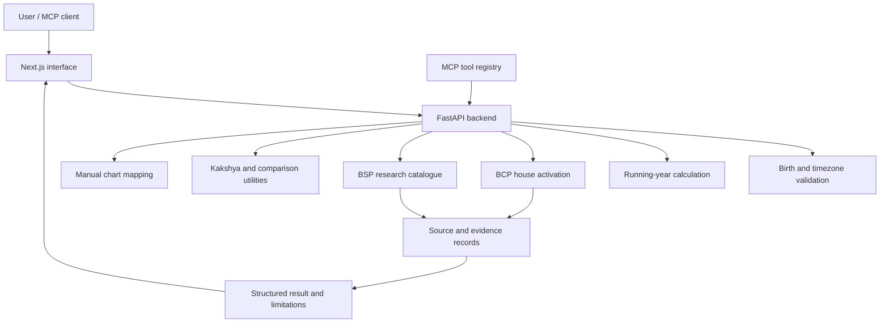

<div align="center">

# BhriguSetu

### A research-first Jyotish workspace for Bhrigu Chakra Paddhati and Bhrigu Saral Paddhati

**Tradition, calculation and interpretation — kept separate, traceable and testable.**

[](https://github.com/beshivaayy/bhrigusetu)
[](https://fastapi.tiangolo.com/)
[](https://nextjs.org/)
[](https://modelcontextprotocol.io/)

[Overview](#overview) · [Capabilities](#capabilities) · [Calculation standards](#calculation-standards) · [MCP](#model-context-protocol-mcp) · [Run locally](#run-locally) · [Documentation](#documentation)

</div>

---

## Overview

BhriguSetu is an open-source, research-first platform for **Bhrigu Chakra Paddhati (BCP)** and **Bhrigu Saral Paddhati (BSP)**.

> A calculation, a textual rule, a teacher's interpretation and a prediction are four different things. BhriguSetu must never blur them.

The application separates astronomical calculations, BCP arithmetic, BSP research candidates, source evidence and interpretation. Outputs should be reproducible, assumptions visible and uncertainty explicitly labelled.

### What BhriguSetu is — and is not

| It is | It is not |
| --- | --- |
| A structured research and calculation workspace | A black-box prediction generator |
| A source-traceable implementation of selected BCP/BSP methods | A claim that every circulating rule is verified |
| A place to compare calculation settings and reference charts | A claim of desktop JHora parity before validation |
| A project that records uncertainty and conflicting sources | A system that silently merges different Jyotish schools |

## Project principles

1. **Source before rule** — every production rule needs an identifiable source and location.
2. **Calculation before interpretation** — chart placements must be reproducible before interpretation begins.
3. **Attribution before synthesis** — teachers and classical texts are represented distinctly.
4. **Evidence before prediction** — unverified BSP candidates stay disabled.
5. **Transparency over false precision** — unsupported settings and limitations are shown, never hidden.

## Capabilities

This table describes the current repository implementation, not the long-term roadmap.

| Area | Current state | Notes |
| --- | --- | --- |
| Birth details | Implemented | Date, local time, coordinates and IANA timezone validation |
| Birthplace lookup | Implemented | One-shot OpenStreetMap Nominatim search |
| Timezone resolution | Implemented | DST gaps/repeated-time safeguards and UTC conversion |
| Running year | Implemented | Completed years + 1, evaluated in selected local timezone |
| BCP house activation | Implemented | 12-house arithmetic; cycle-swami labels remain provisional |
| BCP trigger-point dates | Disabled | Degree-to-day interpretation needs clarification |
| BSP rule catalogue | Research stage | Source-linked candidates; predictive evaluation disabled |
| BSP-7 Kakshya lookup | Implemented utility | Eight slots of 3°45′ each; not a prediction by itself |
| Natal chart | Implemented, approximate | Astronomy Engine 2.1.19; not JHora parity |
| D1 / D9 | Implemented, approximate | Sidereal positions, whole-sign houses and Navamsa mapping |
| Mean Rahu / Ketu | Implemented | True Node is not implemented in the in-repo engine |
| Multiple ayanamsha choices | Roadmap | Not yet selectable in the in-repo chart engine |
| Bhava / house-system choices | Roadmap | Current in-repo engine uses Whole Sign |
| JHora provider integration | Evaluation / roadmap | Public API/MCP is a candidate provider; schemas and support must be verified |
| JHora reference validation | Pending | Requires controlled reference charts and documented settings |

**Important:** the current in-repo chart engine uses Astronomy Engine with an approximate Lahiri polynomial. It is an initial calculation layer, not the authoritative JHora calculation engine. See [Astronomy and licensing](research/ASTRONOMY_AND_LICENSING.md).

## Calculation standards

### Jagannatha Hora as the reference target

The project's target for chart-calculation validation is **Jagannatha Hora (JHora)**. The intention is to make calculation conventions explicit and selectable rather than hard-code one universal profile.

- [Public REST API reference](https://jagannathahora.com/api-mcp)
- [Public MCP server guide](https://jagannathahora.com/api-mcp/mcp-usage)

The public service documents configurable ayanamsha modes and a Mean / True lunar-node option for supported endpoints. Its documentation states that the service is independent and is **not affiliated with the desktop astrology software or its author**. BhriguSetu will identify the provider accurately and will not imply that the public API is the desktop application itself.

### Planned calculation controls

The settings model is intended to support these controls. Availability depends on the selected provider and its verified request schema.

| Setting | Intended choices / behaviour |
| --- | --- |
| Ayanamsha | Provider-supported modes: Lahiri, True Lahiri, True Chitrapaksha, KP, Raman, Fagan-Bradley, Yukteshwar and documented traditional variants |
| Lunar nodes | Mean Node / True Node |
| Zodiac | Sidereal / Tropical, where supported |
| Observer | Geocentric / Topocentric, where supported |
| Position convention | Apparent / Mean, where supported |
| House system | Whole Sign, Equal, Sripati and other provider-supported systems |
| Chart division | D1 and supported Vargas; division-specific conventions must be preserved |
| Birth time | Local civil time, IANA timezone, historical UTC offset and DST handling |
| Location | Latitude, longitude and elevation where required |

The public API currently documents these 19 ayanamsha identifiers for supported endpoints:

**LAHIRI**, **TRUE_CITRA**, **TRUE_LAHIRI**, **KP**, **FAGAN**, **RAMAN**, **USHASHASHI**, **YUKTESHWAR**, **SURYASIDDHANTA**, **SURYASIDDHANTA_MSUN**, **ARYABHATA**, **ARYABHATA_MSUN**, **SS_CITRA**, **TRUE_REVATI**, **SS_REVATI**, **TRUE_PUSHYA**, **TRUE_MULA**, **KP-SENTHIL**, **SENTHIL**.

For supported REST endpoints, the documented node setting is **node_type: mean | true**. This is a provider capability, **not yet a claim that every BhriguSetu route exposes it**.

### Provider capability rules

- Store the selected provider and its engine revision/version with every result.
- Retain the exact calculation settings used for each chart.
- Disable or reject unsupported options with a clear explanation.
- Never silently replace a requested option with a default.
- Keep display preferences (North / South Indian chart layout, language, theme) separate from astronomical settings.
- Include all calculation settings and provider revision in cache keys.

### JHora validation gate

BhriguSetu will not claim JHora parity until controlled comparisons establish it. The validation suite is intended to compare:

- Sun, Moon, Mercury, Venus, Mars, Jupiter and Saturn longitudes.
- Rahu, Ketu and the selected node convention.
- Ascendant longitude and sign.
- Ayanamsha value and selected mode.
- Nakshatra and pada boundaries.
- D1 and divisional-chart placements.
- Rasi and Bhava / house assignments where applicable.

Reports should include per-body angular error in arcseconds, maximum and median error, boundary mismatches, provider settings and reference provenance. A chart that merely looks similar is not a validation result.

## Interpretation and source policy

The project's preferred modern teaching sources are kept in this order:

1. **Sunil John** — primary priority for BCP/BSP-specific material and source context.
2. **Deepanshu Giri** — second priority for practical teaching and cross-checking.
3. **Sanjay Rath** — third priority for foundational Jyotish research and corroboration.

Other authors and schools may be included as supplementary sources, clearly identified as such. This priority order does not turn a teacher's interpretation into a classical textual rule.

### Classical sources remain a separate evidence layer

Texts such as *Brihat Parashara Hora Shastra*, *Phaladeepika*, *Laghu Parashari* and *Jaimini Sutras* are recorded independently from modern teaching material.

A research record should include, where available:

- Author / tradition and exact work, lecture or course.
- Page, chapter, shloka, timestamp or other source location.
- Original wording or a concise faithful transcription.
- Translation and interpretive notes, distinct from the source text.
- Preconditions, calculation method and worked examples.
- Evidence grade, unresolved questions and conflicting interpretations.

**Disagreements are documented, not averaged into a generic rule.** Generic Parashari principles are not automatically relabelled as BSP rules.

## Model Context Protocol (MCP)

BhriguSetu exposes its existing tools through the Model Context Protocol. The remote endpoint is mounted on the same FastAPI service; it does not require a separate Render service.

**BhriguSetu MCP endpoint:** https://bhrigusetu-api.onrender.com/mcp

The remote endpoint is protected by a Bearer token. Keep the token in an environment variable. Never commit it, paste it into source code or publish it in screenshots.

### Current BhriguSetu MCP tools

| Tool | Purpose |
| --- | --- |
| calculate_running_year_tool | Running-year arithmetic |
| analyze_bcp_tool | BCP house activation and provisional cycle metadata |
| analyze_bsp_tool | Inspect BSP research status |
| get_bsp_rules_tool | Read the source-controlled BSP research catalogue |
| calculate_kakshya_tool | BSP-7 Kakshya slot lookup |
| compare_same_degree_tool | Compare whole-degree numbers |
| search_birthplace_tool | Search birthplace candidates |
| resolve_birth_timezone_tool | Resolve local birth time and DST fold |
| analyze_birth_details_tool | Birth details, running year, BCP/BSP status and approximate chart |
| calculate_birth_chart_tool | Approximate in-repo D1/D9 chart calculation |
| analyze_supplied_chart_tool | Map externally supplied sidereal longitudes |
| get_system_status_tool | Report live capability and methodology status |

Additional MCP interfaces:

- Resource: **bhrigusetu://methodology**
- Prompt: **jyotish_research_analysis**

See [MCP server documentation](docs/MCP_SERVER.md) for local and remote setup.

### Connect with Claude Code (Windows PowerShell)

Ensure **BHRIGUSETU_MCP_TOKEN** exists in your Windows user environment. Do not put the literal token in the command or repository. Use the already configured authenticated MCP connection where possible; see the detailed setup guide for registration and troubleshooting.

### JHora public MCP provider

The public JHora MCP service is separate from BhriguSetu MCP:

~~~text
https://jagannatha-hora-359167915530.europe-west1.run.app/mcp
~~~

Its live tool catalogue is discoverable through MCP tools/list. Provider integration in BhriguSetu is a separate workstream; connecting an AI client directly to that service does not mean BhriguSetu itself has integrated or validated every tool.

## Architecture

~~~mermaid
flowchart TD
    UI["Next.js interface"] --> API["FastAPI API"]
    API --> TIME["Birth-time and timezone validation"]
    API --> BCP["BCP calculation layer"]
    API --> BSP["BSP research catalogue"]
    API --> CHART["Chart calculation adapter"]
    CHART --> LOCAL["In-repo approximate engine"]
    CHART -. planned provider adapter .-> JH["JHora public API / MCP"]
    BCP --> EVIDENCE["Source and evidence records"]
    BSP --> EVIDENCE
    CHART --> REPORT["Calculation metadata and warnings"]
    EVIDENCE --> REPORT
    REPORT --> UI
    MCP["BhriguSetu MCP"] --> API
~~~

### Repository layout

~~~text
bhrigusetu/
├── backend/
│   └── app/
│       ├── astronomy/       # Time, ephemeris and chart calculations
│       ├── bcp/             # BCP running-year and house activation
│       ├── bsp/             # BSP analysis and Kakshya utilities
│       ├── chart/           # Supplied-chart mapping and analysis
│       ├── mcp_server/      # Local and remote MCP tool registry
│       ├── places/          # Birthplace lookup
│       └── rules/           # Source-controlled BSP research catalogue
├── frontend/
│   └── app/                 # Next.js application
├── research/                # Evidence, specifications and conflicts
├── docs/                    # Architecture, deployment and MCP guides
├── docker-compose.yml
├── render.yaml
└── README.md
~~~

## Run locally
<div align="center">

### A research-first workspace for Bhrigu Chakra Paddhati (BCP) and Bhrigu Saral Paddhati (BSP)

**Traditional Jyotish research, implemented with transparent calculations, traceable sources and explicit limitations.**

[](https://github.com/beshivaayy/bhrigusetu)
[](https://fastapi.tiangolo.com/)
[](https://nextjs.org/)
[](https://github.com/beshivaayy/bhrigusetu)

[Overview](#overview) · [Capabilities](#current-capabilities) · [Methodology](#methodology--source-policy) · [Architecture](#architecture) · [Quick start](#quick-start) · [Documentation](#documentation)

</div>

---

## Overview

BhriguSetu is a research-first software project for **Bhrigu Chakra Paddhati (BCP)** and **Bhrigu Saral Paddhati (BSP)**. It brings birth-data validation, running-year arithmetic, house activation, research-rule catalogues and reproducible utilities into one application.

> **A calculation is not an interpretation, an interpretation is not a source, and a source is not automatically a verified rule.**

The project keeps these layers separate so users can inspect how a result was produced, which assumptions were used and what remains uncertain.

## Current capabilities

This table describes the implementation on the `main` branch—not planned work.

| Area | Status | Notes |
| --- | --- | --- |
| Birth details | Implemented | Validates date, local wall time, coordinates and IANA timezone |
| Birthplace search | Implemented | One-shot OpenStreetMap Nominatim lookup with attribution |
| Timezone resolution | Implemented | UTC conversion with DST gap/repeated-time safeguards |
| Running year | Implemented | Birthday-based completed-years-plus-one calculation using selected local date |
| BCP house activation | Implemented | 12-house activation arithmetic based on documented method steps |
| BCP cycle labels | Provisional | Not promoted as verified rules |
| BCP trigger-point dates | Disabled | Degree-to-day interpretation needs source clarification |
| BSP rule catalogue | Research stage | Five source-linked candidates; predictive matching disabled |
| BSP-7 Kakshya | Implemented utility | Eight divisions of 3°45′; lookup only, not a standalone prediction |
| Birth-chart calculation | Implemented, approximate | Astronomy Engine 2.1.19; approximate Lahiri polynomial, mean nodes, whole-sign houses and D1/D9; not JHora parity |
| JHora public REST provider | Implemented as explicit API/MCP option | Configurable ayanamsha, Mean/True node, Drik/SS and Bhava methods; separate provider, not desktop-JHora parity |
| Manual chart import | Implemented | Maps caller-supplied sidereal longitudes; does not verify their ephemeris |
| MCP interface | Implemented | Exposes existing calculation and research functions |

**Scope:** this branch is a partial calculation and research foundation, not a complete horoscope generator or automated prediction service. Chart-engine development is maintained separately and is not a released capability until merged and validated.

## Methodology & source policy

Modern teaching sources are prioritised in this order:

1. **Sunil John** — first priority for BCP/BSP-specific material and source context.
2. **Deepanshu Giri** — second priority for practical teaching and cross-checking.
3. **Sanjay Rath** — third priority for foundational Jyotish research and corroboration.

Other authors may be included as supplementary references, clearly attributed. Different teachers' views must not be silently merged into one generic rule.

### Classical texts are a separate evidence layer

Classical works such as *Brihat Parashara Hora Shastra*, *Phaladeepika*, *Laghu Parashari* and *Jaimini Sutras* are recorded separately from modern lectures, courses and interpretations.

Each research entry should identify the source and exact location (chapter, shloka, page or timestamp), distinguish original wording from interpretation, state preconditions, include a worked example and record evidence status and conflicts. A general Parashari principle is not automatically a BCP or BSP rule.

### Evidence before prediction

Before a rule can be enabled, it needs a traceable source and exact location, clear preconditions and calculation steps, a reproducible worked example, conflict review, deterministic implementation and regression tests. Unverified BSP candidates remain disabled. Conflicts are documented, not averaged away.

## Calculation integrity

Calculation conventions materially affect chart results. BhriguSetu treats birth date, local civil time, coordinates, IANA timezone, UTC conversion and calculation-provider settings as explicit inputs.

**Jagannatha Hora (JHora) is the intended reference target for chart-calculation validation.** The `main` branch contains an initial approximate birth-chart engine, but it does not claim JHora parity. The in-repo engine uses Astronomy Engine 2.1.19, an approximate Lahiri polynomial, Mean Nodes and Whole Sign houses; True Node, alternative ayanamsha modes and alternative bhava systems are not implemented in that engine. Any provider integration must expose only verified settings, preserve the exact calculation profile and reject unsupported options rather than silently substituting defaults.

- [JHora public REST API](https://jagannathahora.com/api-mcp)
- [JHora public MCP guide](https://jagannathahora.com/api-mcp/mcp-usage)

The public API/MCP service is a separate provider; it must not be described as the desktop JHora application itself. BhriguSetu now exposes an explicit public REST provider path; its calculation receipt preserves requested/applied settings and engine revision.

## Acknowledgements & source credits

BhriguSetu is built with gratitude to the teachers, authors, researchers and knowledge traditions from which its creator has learned. The project aims to acknowledge intellectual contributions clearly and respectfully.

### Teachers and guiding influences

Our special gratitude goes to:

- **Sunil John** — for the teachings, guidance and knowledge that have helped shape the creator's understanding and research into Bhrigu Chakra Paddhati (BCP) and Bhrigu Saral Paddhati (BSP).
- **Deepanshu Giri** — for sharing Jyotish knowledge, practical insights and teaching that have contributed to the creator's learning and continued study.
- **Sanjay Rath** — for his extensive contributions to Jyotish education, traditional study and the wisdom that has informed the creator's learning and research approach.

These acknowledgements express gratitude for learning and intellectual influence. They do not imply endorsement of BhriguSetu, collaboration, affiliation or review by the individuals named. Their teachings and authored materials remain theirs; BhriguSetu does not claim ownership over them.

### Other teachers, authors and researchers

We are also grateful to every other Jyotish teacher, author, scholar and researcher whose publicly shared or properly accessed work informs a specific part of this project. They will be credited by name alongside the relevant research entry, with a source link and—where available—a lecture timestamp, publication, page or chapter reference. No contributor should be represented as a source for a rule unless that attribution has been verified.

### Classical knowledge and information sources

BhriguSetu also acknowledges the authorship, preservation, translation and scholarship associated with classical Jyotish works, including *Brihat Parashara Hora Shastra*, *Phaladeepika*, *Laghu Parashari* and *Jaimini Sutras*. Specific editions, translators, editors and shloka references will be identified wherever they are used; traditional knowledge is not claimed as original project intellectual property.

Software libraries, ephemeris/calculation providers, APIs, datasets, documentation, open-source maintainers and other information providers will be credited in the relevant notices or source registers according to their licences and attribution terms. The [Source matrix](research/SOURCE_MATRIX.md) records research references and evidence status.

**Our principle:** give credit where knowledge came from, distinguish quotation from interpretation and distinguish both from BhriguSetu's own implementation or analysis. If a source or contributor is missing or incorrectly attributed, please open an issue so the record can be corrected.

See [Acknowledgements and attribution policy](ACKNOWLEDGEMENTS.md) for the full credit standard.

## Architecture



| Repository path | Responsibility |
| --- | --- |
| `frontend/` | Next.js + TypeScript user interface |
| `backend/` | FastAPI application and calculation modules |
| `research/` | Method specifications, source matrix and conflicts |
| `docs/` | Architecture, MCP, deployment and implementation guides |

## Quick start

### Requirements

Python 3.12 recommended, Node.js/npm compatible with the frontend lockfile, and Git. Docker Desktop is optional.

### 1. Clone

```powershell
git clone https://github.com/beshivaayy/bhrigusetu.git
cd bhrigusetu
```

### 2. Backend

```powershell
cd backend
py -3.12 -m venv .venv
.\.venv\Scripts\Activate.ps1
python -m pip install -r requirements.txt
python -m uvicorn app.main:app --reload --port 8000
```

API health: [http://localhost:8000/health](http://localhost:8000/health) · API docs: [http://localhost:8000/docs](http://localhost:8000/docs)

### 3. Frontend

Open a second terminal from the repository root:

```powershell
cd frontend
npm ci
$env:NEXT_PUBLIC_API_BASE_URL = "http://localhost:8000"
npm run dev
```

Open [http://localhost:3000](http://localhost:3000).

### 4. Tests

```powershell
cd backend
python -m pytest -q
```

### 5. Docker (optional)

From the repository root:

```powershell
docker compose up --build
```

Open [http://localhost:3000](http://localhost:3000). Stop with `Ctrl+C`, then run `docker compose down`.

### Requirements

- Python 3.12
- Node.js compatible with the installed Next.js version
- npm and Git
- Docker Desktop (optional)

### 1. Clone the repository

~~~powershell
git clone https://github.com/beshivaayy/bhrigusetu.git
cd bhrigusetu
~~~

### 2. Start the backend

~~~powershell
cd backend
py -3.12 -m venv .venv
.\.venv\Scripts\Activate.ps1
python -m pip install -r requirements.txt
uvicorn app.main:app --reload --port 8000
~~~

Backend endpoints:

- Health: [http://localhost:8000/health](http://localhost:8000/health)
- OpenAPI / Swagger: [http://localhost:8000/docs](http://localhost:8000/docs)
- Analysis: POST /api/analyze
- Chart: POST /api/chart/calculate
- Manual chart mapping: POST /api/chart/manual
- MCP: /mcp (remote deployment requires Bearer authentication)

### 3. Start the frontend

Open a second PowerShell window:

~~~powershell
cd bhrigusetu\frontend
npm ci
$env:NEXT_PUBLIC_API_BASE_URL = "http://localhost:8000"
npm run dev
~~~

Open [http://localhost:3000](http://localhost:3000).

### 4. Run backend tests

~~~powershell
cd bhrigusetu\backend
python -m pytest -q
~~~

### 5. Run with Docker (optional)
| Variable | Component | Purpose |
| --- | --- | --- |
| `CORS_ORIGINS` | Backend | Comma-separated allowed frontend origins |
| `NEXT_PUBLIC_API_BASE_URL` | Frontend | FastAPI base URL; defaults to `http://localhost:8000` |

Never commit API keys, tokens, passwords or local environment files. Use HTTPS for deployed API origins and configure CORS for the exact frontend origin.

## Deployment

The intended split deployment is **Vercel** for the frontend (root directory `frontend/`) and **Render** for the backend (repository Render configuration and backend Dockerfile). Configuration files do not guarantee that a service is deployed or healthy. Follow [docs/DEPLOYMENT.md](docs/DEPLOYMENT.md) and verify the deployed commit, health checks, CORS and logs.

## Ownership and distribution

BhriguSetu follows a **hybrid product model**: the hosted product and selected public interfaces may be accessible, while the proprietary calculation, research and service implementation is intended to remain private. The repository is currently public; the private-core separation is a migration target, not yet completed. See [Ownership and distribution policy](docs/OWNERSHIP_AND_DISTRIBUTION.md).

**Current source status:** no project-level software licence has been added. The absence of a licence does not make the project open source; default copyright applies to original project code. GitHub users can still view and fork a public repository under GitHub's platform terms. Public visibility also means the existing source, branches and history have already been exposed; changing visibility later cannot recall existing public forks or local copies.

Do not treat third-party libraries, public-domain/classical texts, teacher-authored material, public API providers or user-supplied data as BhriguSetu-owned intellectual property. Their respective rights, licences, terms and attribution requirements remain separate.

## External services, privacy & licensing

- Birthplace lookup uses OpenStreetMap Nominatim. Attribution is displayed; follow its usage policy and do not turn one-shot lookup into uncontrolled autocomplete.
- The `main` branch includes an approximate ephemeris chart engine; it is not validated for JHora parity or precision-sensitive predictions. See [Astronomy and licensing](research/ASTRONOMY_AND_LICENSING.md).
- Swiss Ephemeris is not bundled. Its dual-licensing requirements need an explicit AGPL-compliance or professional-licence decision before integration.
- Birth date, time and location are personal data. Review hosting and external-provider privacy terms before sending them to third-party services.
- No project-level `LICENSE` file is currently present; reuse and redistribution terms have not been formally declared. Third-party dependencies retain their own licences.

## Documentation

| Document | Description |
| --- | --- |
| [Acknowledgements](ACKNOWLEDGEMENTS.md) | Gratitude to teachers and point-of-use attribution for research, classical, technical and community sources |
| [Architecture](docs/ARCHITECTURE.md) | Application layers and responsibility boundaries |
| [MCP server](docs/MCP_SERVER.md) | Available tools, transports and client setup |
| [JHora REST provider contract](docs/JHORA_REST_PROVIDER_CONTRACT.md) | Verified settings, provider attribution, failure handling and parity gates |
| [Deployment](docs/DEPLOYMENT.md) | Render, Vercel, CORS and release verification |
| [Place search](docs/PLACE_SEARCH.md) | Nominatim usage and timezone lookup safeguards |
| [Manual chart import](docs/MANUAL_CHART_IMPORT.md) | Caller-supplied longitudes and mapping limitations |
| [Astronomy & licensing](research/ASTRONOMY_AND_LICENSING.md) | Ephemeris choices, precision and licensing |
| [BCP specification](research/BCP_SPECIFICATION.md) | BCP calculation scope and assumptions |
| [BCP cycle-lord evidence](research/BCP_CYCLE_LORD_EVIDENCE.md) | Evidence for provisional cycle-ruler mapping |
| [BCP trigger points](research/BCP_TRIGGER_POINTS.md) | Unresolved trigger-point method |
| [BSP specification](research/BSP_SPECIFICATION.md) | BSP research scope and implementation boundaries |
| [BSP rule register](research/BSP_RULE_REGISTER.md) | Candidate rules, sources and verification status |
| [Source matrix](research/SOURCE_MATRIX.md) | Source inventory and evidence status |
| [Conflicts](research/CONFLICTS.md) | Conflicting interpretations and open questions |

## Contributing

Until the private-core split and contributor terms are in place, use public issues and pull requests for documentation corrections, reproducible bug reports and discussion; do not assume a code contribution grants or transfers intellectual-property rights. Contributions to proprietary components require a written contributor/IP agreement before acceptance. A BCP/BSP research proposal must include its source, exact location, preconditions, worked example, expected output and regression test. Unattributed predictions should not be submitted as established doctrine.

---

<div align="center">

Open [http://localhost:3000](http://localhost:3000). Stop the stack with:
**BhriguSetu** · Bridging traditional Jyotish research and disciplined software engineering.

[Repository](https://github.com/beshivaayy/bhrigusetu) · [Issues](https://github.com/beshivaayy/bhrigusetu/issues) · [JHora API](https://jagannathahora.com/api-mcp)

## Configuration

| Variable | Component | Description |
| --- | --- | --- |
| NEXT_PUBLIC_API_BASE_URL | Frontend | FastAPI base URL; defaults to http://localhost:8000 |
| CORS_ORIGINS | Backend | Comma-separated allowed frontend origins |
| BHRIGUSETU_MCP_TOKEN | Backend | Bearer token protecting the remote MCP endpoint |

Do not commit environment files, API tokens or credentials. Use HTTPS for deployed API origins and restrict CORS to the actual frontend origin.

## Deployment

The repository includes configuration for a split deployment:

- **Frontend:** Vercel, with frontend/ as the project root.
- **Backend + MCP:** Render, using the repository-root render.yaml and backend/Dockerfile.

The remote MCP endpoint is mounted inside the existing API service. Keep the MCP token in the Render environment and the matching client environment; never expose it in client-side frontend variables.

See [Deployment guide](docs/DEPLOYMENT.md). A deployment configuration file does not, by itself, guarantee that a service is deployed or healthy.

## Privacy, external services and licensing

- Birthplace search uses OpenStreetMap Nominatim. The UI displays attribution; follow its usage policy and do not turn one-shot search into uncontrolled autocomplete.
- The in-repo chart engine currently uses Astronomy Engine 2.1.19 and an approximate Lahiri polynomial. Provider/version and calculation warnings accompany chart output.
- Swiss Ephemeris is not bundled. Its dual licensing requires a deliberate AGPL-compliance or professional-licence decision before integration.
- The public JHora API has its own usage terms, rate limits and availability conditions. Credit the provider, cache appropriately and do not assume an uptime guarantee.
- Review each external provider's privacy and retention documentation before sending birth details. Send sensitive request data in documented request bodies, not URLs.

See [Astronomy and licensing](research/ASTRONOMY_AND_LICENSING.md) and [Place search](docs/PLACE_SEARCH.md).

## Roadmap

- [x] BCP running-year and 12-house activation foundation.
- [x] Source-controlled BSP research catalogue with predictive rules disabled.
- [x] BSP-7 Kakshya lookup utility.
- [x] FastAPI service and Next.js interface.
- [x] BhriguSetu MCP server with remote authenticated endpoint.
- [x] Initial approximate D1/D9 chart engine and invariant tests.
- [ ] Verify public JHora MCP tool schemas and REST API request contracts.
- [ ] Build a provider capability matrix for ayanamsha, node type, observer, position and house-system options.
- [ ] Add per-chart calculation profiles and persist the full settings receipt.
- [ ] Integrate the selected JHora provider without misrepresenting it as the desktop application.
- [ ] Build desktop-JHora reference fixtures and angular-error comparison reports.
- [ ] Expand validated divisional-chart and Bhava / house-system support.
- [ ] Verify BCP cycle-swami and trigger-point interpretations from primary sources.
- [ ] Enable BSP predictive rules only after provenance, worked examples and regression tests pass.

## Documentation

| Document | What it covers |
| --- | --- |
| [Architecture](docs/ARCHITECTURE.md) | Application layers and responsibility boundaries |
| [MCP server](docs/MCP_SERVER.md) | Tools, transports and client setup |
| [Deployment](docs/DEPLOYMENT.md) | Render, Vercel, CORS and release checks |
| [Place search](docs/PLACE_SEARCH.md) | Nominatim, timezone lookup and usage safeguards |
| [Manual chart import](docs/MANUAL_CHART_IMPORT.md) | Caller-supplied longitudes and mapping limitations |
| [Astronomy and licensing](research/ASTRONOMY_AND_LICENSING.md) | Ephemeris choices, precision and licensing |
| [BCP specification](research/BCP_SPECIFICATION.md) | Current BCP calculation specification |
| [BCP cycle-lord evidence](research/BCP_CYCLE_LORD_EVIDENCE.md) | Evidence and provisional cycle-ruler mapping |
| [BCP trigger points](research/BCP_TRIGGER_POINTS.md) | Unresolved trigger-point method |
| [BSP specification](research/BSP_SPECIFICATION.md) | BSP scope and implementation boundary |
| [BSP rule register](research/BSP_RULE_REGISTER.md) | Candidate rules, sources and validation status |
| [BSP Kakshya evidence](research/BSP_KAKSHYA_EVIDENCE.md) | Kakshya lookup research |
| [Source matrix](research/SOURCE_MATRIX.md) | Source inventory and evidence status |
| [Conflicts](research/CONFLICTS.md) | Conflicting interpretations and unresolved questions |
| [Security policy](SECURITY.md) | Reporting security issues |

## Contributing

Contributions are welcome, especially in:

- Reproducible chart fixtures and independent calculation comparisons.
- Primary-source references and careful source transcription.
- Tests for boundaries, timezone transitions and divisional-chart calculations.
- Documentation improvements and provider capability audits.

Before proposing a predictive rule, include its source, exact location, preconditions, worked example, expected output and regression test. Do not submit unattributed rules as established BCP/BSP doctrine.

## Licence

No project licence file is currently present, so reuse terms for this repository have not yet been formally declared. Third-party libraries, data and external calculation services remain subject to their own licences and terms. A project licence should be selected before inviting external contributions or redistribution.

---

<div align="center">

**BhriguSetu** · Built for careful calculation, honest research and traceable Jyotish.

[Repository](https://github.com/beshivaayy/bhrigusetu) · [Issues](https://github.com/beshivaayy/bhrigusetu/issues) · [JHora API](https://jagannathahora.com/api-mcp)

</div>
